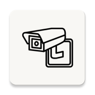
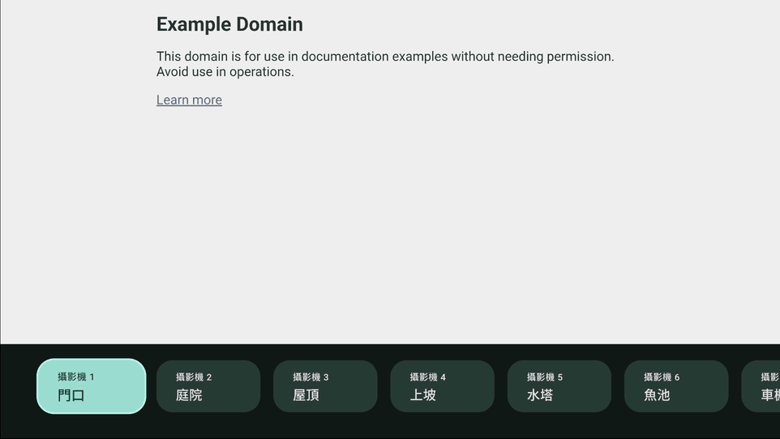

<div align="center">



<h1>監視器</h1>
<h4>供個人使用的 Android TV 攝影機檢視工具</h4>


<p>
  <a href="#preview">Preview</a> •
  <a href="#features">功能</a> •
  <a href="#configuration">攝影機設定</a> •
  <a href="#installation">建置與安裝</a> •
  <a href="#credits">素材來源</a> •
  <a href="#license">授權</a>
</p>
</div>

## Preview



<a id="features"></a>

## 功能

- 在你家電視上看你家監視器畫面

本專案供安裝至自有電視使用，不以應用程式商店發布為目標。

<a id="configuration"></a>

## 攝影機設定

### 使用手機設定

1. 手機與電視連上可互通的區域網路，電視可使用 Wi-Fi 或有線連線。
2. 在攝影機清單最右側選擇「設定」，或按遙控器的選單鍵。
3. 手機掃描電視上的 QR Code，在瀏覽器修改八組名稱與網址後按「儲存設定」。
4. 完成後關閉電視上的設定視窗。關閉視窗或離開應用程式後，臨時連結即失效。

設定會保存在電視的 DataStore，重開應用程式後仍會保留，不需要重新建置。修改名稱不會中斷畫面；修改目前觀看的網址時才會重新載入。設定視窗開啟期間暫停清單的自動隱藏。

設定服務使用 IPv4 與 HTTP，僅供可信任的區域網路使用；臨時連結限制存取，但不加密傳輸。

### 建置時的初始設定（選用）

首次設定時，在專案根目錄複製 [cameras.example.properties](cameras.example.properties)：

```sh
cp -n cameras.example.properties cameras.local.properties
```

編輯 `cameras.local.properties`，填入八組名稱與網頁網址。以下網址僅供示意：

```properties
camera.1.name=攝影機 1
camera.1.url=http://192.0.2.10/view?channel=1&mode=live
```

`cameras.local.properties` 已加入 `.gitignore`，只供本機使用。`local.properties` 則保留給 Android Studio 管理 SDK 路徑。

Android Studio 與命令列建置都會透過 Gradle 讀取本機設定並產生 `BuildConfig`，由 `BuildConfigCameraDefaults` 提供初始值。手機儲存過設定後，電視會優先使用 DataStore 的內容，更新安裝檔不會覆蓋已儲存的設定。

若要分享不含私人初始值的安裝檔，可使用 `./gradlew :app:assembleDebug -PincludeLocalCameras=false`。若要重新採用建置初始值，需在電視的系統設定中清除本應用程式資料。

第一組設定就是啟動時載入的攝影機。沒有本機設定檔時仍可建置，初始顯示八個通用名稱及空白網址，再透過手機完成設定；網址留空則顯示尚未設定的訊息。

- 網址須使用 `http://` 或 `https://`。應用程式未內建 RTSP 播放器。
- 設定檔使用 UTF-8，可直接填入中文；值不需要加引號。
- 網址中的 `&` 直接保留，不要寫成 `&amp;`；單引號不需跳脫。若值包含反斜線，請寫成 `\\`。
- 電視須能連線至攝影機所在的網路。
- 已啟用網頁指令碼、網頁儲存空間與媒體自動播放；攝影機網頁須能自動顯示影像。
- 允許 HTTP 連線，但不會略過無效的 HTTPS 安全性憑證。

攝影機網頁的內容與語言由攝影機本身提供。

<a id="installation"></a>

## 建置與安裝

### 環境需求

- Android TV，Android 8.0（API 26）以上版本
- Android SDK 37
- JDK 21，依專案的 Gradle 工具鏈設定使用

以 Android Studio 開啟專案並完成 Gradle 同步後選擇 Run 'app'

<a id="credits"></a>

## 素材來源

- 應用程式圖示：[Flaticon 監視攝影機圖示](https://www.flaticon.com/free-icon/security-camera_7144872)
- 電視橫幅圖片使用字型：[justfont「jf open 粉圓」](https://justfont.com/huninn/)

<a id="license"></a>

## 授權

尚未決定
