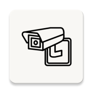
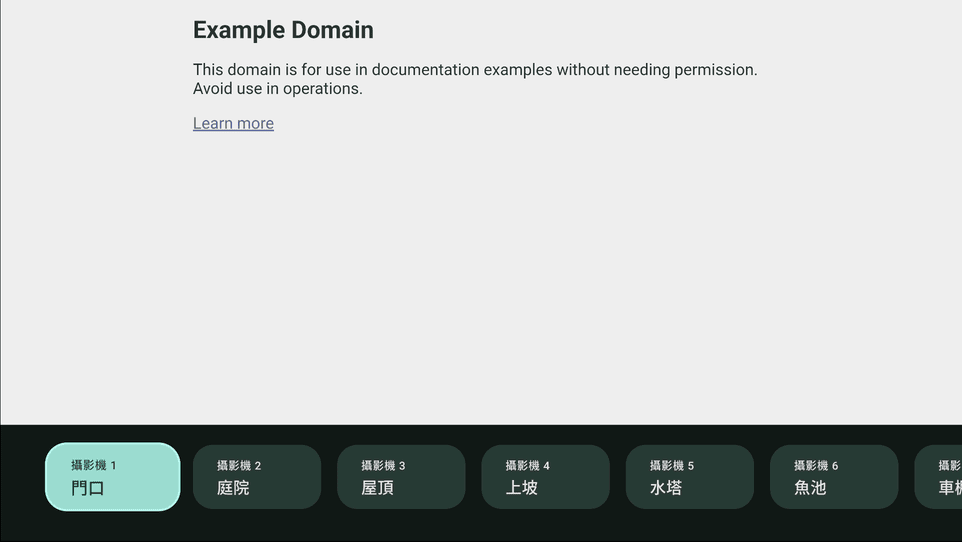
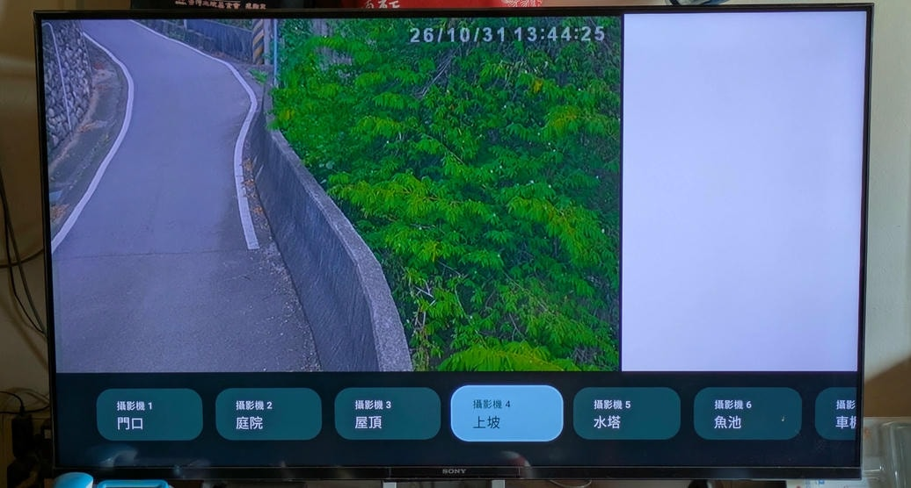

<div align="center">



<h1>監視器</h1>
<h4>在你的 Android TV 看你家的監視器</h4>

<p><strong>繁體中文</strong> | <a href="README.en-US.md" lang="en-US">English (US)</a></p>


<p>
  <a href="#preview">Preview</a> •
  <a href="#features">功能</a> •
  <a href="#installation">如何安裝</a> •
  <a href="#configuration">攝影機設定</a> •
  <a href="#build-and-install">建置與安裝</a> •
  <a href="#credits">素材來源</a> •
  <a href="#license">授權</a>
</p>
</div>

## Preview

### Screenshot


### On Sony TV


<a id="features"></a>

## 功能

- 完全支援遙控器上下左右操作
- 最多可設定 8 路影像
- 使用手機快速設定攝影機網址
- 每 30 秒自動重整網頁

<a id="installation"></a>

## 如何安裝

1. 從 [GitHub Release](/releases) 下載最新版。
2. 使用 [Send Files to TV](https://www.sendfilestotv.app/) 將 APK 傳輸至電視。
3. 安裝，大功告成！

<a id="configuration"></a>

## 如何設定攝影機

### 方法一：安裝後使用手機設定（推薦）

1. **電視** 與 **手機** 連線到同一個網路。
2. 在 **電視** 上的攝影機清單滑至最右側，選擇「設定」。
3. 掃描 **電視** 上的 QR Code 即可在手機上設定監視器網址。

### 方法二：Build from Source（進階）

1. 從範例檔開始 [cameras.example.properties](cameras.example.properties)：

    ```sh
    cp -n cameras.example.properties cameras.local.properties
    ```

2. 編輯 `cameras.local.properties`，填入八組名稱與網頁網址。例如：

    ```properties
    camera.1.name=攝影機 1
    camera.1.url=http://192.0.2.10/view?channel=1&mode=live
    ```

3. 注意事項

   - 網址須為 `http://` 或 `https://`；不支援 RTSP/RTMP。
   - 設定檔使用 UTF-8，可直接填入中文，值不需加引號。
   - 網址中的 `&` 直接保留，不要寫成 `&amp;`；單引號不需跳脫；若值包含反斜線，請寫成 `\\`。
   - 已啟用網頁指令碼、網頁儲存空間與媒體自動播放。

<a id="build-and-install"></a>

## 建置與安裝

### 環境需求

- Android TV (Android 8, API 26)
- Android SDK 37
- JDK 21

Sync Gradle and Run 'app'

<a id="credits"></a>

## 素材來源

- 應用程式圖示：[Flaticon 監視攝影機圖示](https://www.flaticon.com/free-icon/security-camera_7144872)
- 電視橫幅圖片使用字型：[justfont「jf open 粉圓」](https://justfont.com/huninn/)

<a id="license"></a>

## 授權

[MIT License](LICENSE). Third-party materials retain their own licenses; see [Third-Party Notices](THIRD_PARTY_NOTICES.md).
