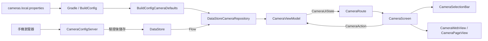

# 軟體架構

採用 ViewModel 與單向資料流。`CameraRepository` 以 Flow 提供攝影機設定，`CameraViewModel` 以 `StateFlow<CameraUiState>` 提供狀態，畫面透過 `CameraAction` 回報操作。

| 位置 | 用途 |
| --- | --- |
| `data/` | 攝影機資料模型、設定驗證、BuildConfig 初始值及 DataStore 持久化。 |
| `network/` | 區網位址選擇、限此次連結存取的 HTTP 服務與手機表單。 |
| `ui/activity/` | 應用程式入口、視窗設定及相依物件建立。 |
| `ui/viewmodel/` | 選取狀態、設定資料收集、設定視窗、重新載入指令及 10 秒閒置計時。 |
| `ui/screen/` | 生命週期感知的狀態收集、遙控器事件轉換與畫面組合。 |
| `ui/component/` | 清單動畫、焦點、錯誤提示、網頁生命週期及手機設定 QR Code 視窗。 |
| `ui/web/` | 原生網頁設定、載入回呼、載入狀態與資源釋放。 |
| `ui/theme/` | Material 3 深色主題。 |
| `ui/preview/` | 不含私人網址的 Compose 預覽示範資料。 |
| `cameras.example.properties` | 可提交的攝影機設定範例。 |
| `cameras.local.properties` | 已忽略的本機私人設定。 |
| `app/build.gradle.kts` | 讀取設定、處理字串跳脫並產生 BuildConfig。 |

程式碼套件位於 `app/src/main/java/com/txwstudio/app/cctvviewer/`，資源位於 `app/src/main/res/`。

ViewModel 使用 `SavedStateHandle` 保存目前攝影機、焦點項目及選單顯示狀態。原生網頁由介面層建立及銷毀，不存入 ViewModel；進入背景時仍會立即釋放，回到前景後重建。動畫、焦點及網頁載入進度屬於介面狀態，由對應元件管理。

ViewModel 單元測試位於 `app/src/test/java/com/txwstudio/app/cctvviewer/ui/viewmodel/`，使用替代資料來源與協程虛擬時間，驗證選取流程、狀態恢復及閒置計時，不會連線至攝影機。

## 手機設定

`CameraSettingsDialog` 開啟時，依電視的 Wi-Fi 或乙太網路介面取得 IPv4 位址，並在該位址啟動 `CameraConfigServer`。系統配置可用的連接埠，每次產生新的隨機存取路徑；關閉視窗或生命週期進入背景時停止服務，返回前景則產生新的連結。

手機頁面使用伺服器產生的 HTML 表單，不依賴外部網站、JavaScript 或雲端服務。GET 讀取目前設定，POST 驗證完整的八組資料後，以 DataStore 交易一次儲存；成功後重新導向確認頁。伺服器限制內容大小，拒絕不同來源的表單提交，並禁止快取。HTTP 本身不提供傳輸加密。

`DataStoreCameraRepository` 只在尚未儲存設定時採用建置初始值。ViewModel 收到設定變更後保留目前選取狀態；只有作用中攝影機的網址變更才增加 `reloadVersion`。設定視窗開啟時暫停閒置計時，關閉後重新計時。儲存內容位於應用程式私有儲存空間，不會寫回 properties 或原始碼。

DataStore 持久化測試位於 `app/src/test/java/com/txwstudio/app/cctvviewer/data/`；HTTP 測試位於 `app/src/test/java/com/txwstudio/app/cctvviewer/network/`，使用 loopback 連線與示範資料驗證存取限制、字串跳脫、輸入驗證與儲存行為。

## Compose 預覽

在 Android Studio 開啟下列 Kotlin 檔案，切換至設計或分割檢視，即可查看標示 `@Preview` 的元件。完整觀看畫面使用 960 × 540 dp 的橫向尺寸，預覽語系為臺灣繁體中文。

| 檔案 | 預覽內容 |
| --- | --- |
| `ui/screen/CameraScreen.kt` | 顯示清單、隱藏清單的全畫面模式。 |
| `ui/component/CameraSelectionBar.kt` | 橫向攝影機清單，區分正在觀看與聚焦的項目。 |
| `ui/component/CameraButton.kt` | 一般及已選取按鈕。 |
| `ui/component/CameraWebView.kt` | 攝影機網頁區域的示意畫面。 |
| `ui/component/CameraPageOverlay.kt` | 載入進度、尚未設定、載入失敗及憑證錯誤。 |
| `ui/component/CameraSettingsDialog.kt` | QR Code、臨時網址與關閉按鈕。 |

預覽使用示範資料，不讀取私人設定或建立 ViewModel。設計預覽中的網頁區域透過 `LocalInspectionMode` 顯示示意區塊，不建立原生 WebView；實際網頁播放仍需在模擬器或電視上驗證。

[返回專案說明](../README.md)
