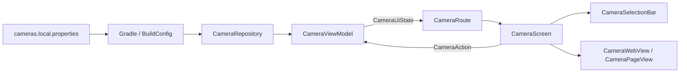

# 軟體架構

採用 ViewModel 與單向資料流。`CameraRepository` 讀取攝影機設定，`CameraViewModel` 以 `StateFlow<CameraUiState>` 提供狀態，畫面透過 `CameraAction` 回報操作。

| 位置 | 用途 |
| --- | --- |
| `data/` | 攝影機資料模型、資料來源介面與 BuildConfig 讀取實作。 |
| `ui/activity/` | 應用程式入口、視窗設定及相依物件建立。 |
| `ui/viewmodel/` | 選取狀態、選單顯示、重新載入指令及 10 秒閒置計時。 |
| `ui/screen/` | 生命週期感知的狀態收集、遙控器事件轉換與畫面組合。 |
| `ui/component/` | 清單動畫、焦點與捲動、錯誤提示、進度顯示及網頁生命週期綁定。 |
| `ui/web/` | 原生網頁設定、載入回呼、載入狀態與資源釋放。 |
| `ui/theme/` | Material 3 深色主題。 |
| `cameras.example.properties` | 可提交的攝影機設定範例。 |
| `cameras.local.properties` | 已忽略的本機私人設定。 |
| `app/build.gradle.kts` | 讀取設定、處理字串跳脫並產生 BuildConfig。 |

程式碼套件位於 `app/src/main/java/com/txwstudio/app/cctvviewer/`，資源位於 `app/src/main/res/`。

ViewModel 使用 `SavedStateHandle` 保存目前攝影機、焦點項目及選單顯示狀態。原生網頁由介面層建立及銷毀，不存入 ViewModel；進入背景時仍會立即釋放，回到前景後重建。動畫、焦點及網頁載入進度屬於介面狀態，由對應元件管理。

ViewModel 單元測試位於 `app/src/test/java/com/txwstudio/app/cctvviewer/ui/viewmodel/`，使用替代資料來源與協程虛擬時間，驗證選取流程、狀態恢復及閒置計時，不會連線至攝影機。

[返回專案說明](../README.md)
